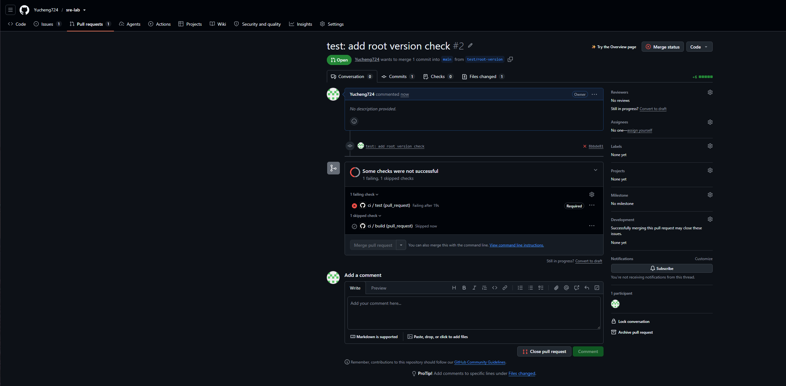

# sre-lab

從零打造一套 SRE 實作環境：服務 → 容器化 → CI → IaC → 可觀測性 → GitOps，全部使用免費工具在本機完成。

## Roadmap

- [x] Stage 1：FastAPI 服務（`/health`、`/metrics`、可注入故障的 `/work`）
- [x] Stage 2：Docker 化（multi-stage、非 root）
- [x] Stage 3：CI（GitHub Actions → GHCR）
- [x] Stage 4：Terraform 建立 kind 叢集並部署
- [ ] Stage 5：Prometheus / Grafana 監控、SLO 與燃燒率告警
- [ ] Stage 6：Helm + ArgoCD GitOps、HPA
- [ ] 壓測、故障演練與 postmortem

## 本機執行

```bash
uv venv --python 3.12 && source .venv/bin/activate
uv pip install -r app/requirements.txt -r requirements-dev.txt
python -m pytest -q
uvicorn app.main:app --reload
```

## 端點

| 端點 | 說明 |
|---|---|
| `/` | 回傳版本資訊 |
| `/health` | 健康檢查 |
| `/metrics` | Prometheus 指標 |
| `/work` | 模擬工作；以 `ERROR_RATE`、`MAX_DELAY` 環境變數注入錯誤與延遲，供 SLO 告警與故障演練使用 |

## 環境建置踩雷紀錄

- 在 PowerShell 執行 Linux 指令失敗 → 需先進入 WSL（Ubuntu）
- `ssh-keygen` 誤輸入檔名導致金鑰路徑錯誤 → 預設路徑直接按 Enter
- kind 下載網址版本號未替換，下載到 404 頁面 → 改用 GitHub API 自動取得最新版本
- ruff 檢查出 import 排序問題（I001）→ `ruff check --fix` 自動修正

## Stage 2：Docker 化

| Image | 磁碟大小 | 傳輸大小 |
|---|---|---|
| 單階段（`python:3.12`） | 1.65 GB | 427 MB |
| multi-stage（`python:3.12-slim`） | 203 MB | 49.1 MB |

- 縮小約 88%：主要來自 slim 基底 image；multi-stage 讓 pip 快取與建置暫存不進入最終 image
- 以非 root 使用者（UID 10001）執行，符合最小權限原則
- HEALTHCHECK 定期呼叫 `/health`
- 調整 COPY 順序以善用 build cache：只改程式碼時不需重裝套件
- `compose.yaml` 可注入 10% 錯誤率與隨機延遲，驗證 20 次請求中出現 2 次 500

### 踩雷紀錄
- `docker run -d` 後立刻 curl 出現 Connection reset：容器啟動不等於服務就緒 → 之後在 K8s 以 readinessProbe 處理
- 新電腦執行 docker 出現 permission denied：使用者需加入 docker 群組並重新登入

## Stage 3：CI（GitHub Actions → GHCR）

- push / PR 時執行 ruff 與 pytest；測試通過且為 push 到 main 時，才建置 image 並推送至 GHCR
- image 同時標記 `latest` 與 commit SHA，可追溯每個版本並精準回滾
- 使用 `GITHUB_TOKEN` 登入 GHCR，不需自行保存密碼

### 踩雷紀錄
- GHCR 要求 image 名稱全小寫，帳號含大寫字母 → 在 workflow 以 `${GITHUB_REPOSITORY,,}` 轉為小寫
- 本機 ruff 通過、CI 卻失敗（import 排序判斷不同）→ 原因是 ruff 未固定版本、first-party 判斷依賴預設值；以 `pyproject.toml` 明確設定 `known-first-party` 並固定 ruff 版本，確保本機與 CI 一致
- Actions 出現 Node.js 20 淘汰警告 → 升級 `actions/checkout@v5`、`actions/setup-python@v6`

### 分支保護

`main` 以 GitHub Ruleset 保護：所有變更必須透過 PR，且 `test` 檢查通過才能合併。下圖為故意提交錯誤測試時，PR 被擋下、無法合併的畫面：



## Stage 4：Terraform + kind

- 以 Terraform 建立 kind 叢集（1 control-plane + 1 worker），並部署 Deployment（含 readiness / liveness probe、resource limits）與 NodePort Service
- 整套環境可一鍵重建：`terraform destroy` → `terraform apply` 約 55 秒（image 已快取；首次約 3～5 分鐘）
- 練習變更管理：修改 replicas 時，plan 只顯示 1 個資源變更
- Drift 偵測：以 kubectl 手動 scale 後，`terraform plan` 偵測到 `replicas 1 -> 3` 並改回
- 使用 `plan -out` 確保套用的內容就是審核過的計畫
- `.terraform.lock.hcl` 納入版控，固定 provider 版本
- CI 加入 `terraform fmt -check` 與 `validate`

### 踩雷紀錄
- 將 `terraform apply` 與其他指令一起貼上，下一行被當成確認輸入而取消 → 需要確認的指令應單獨執行
